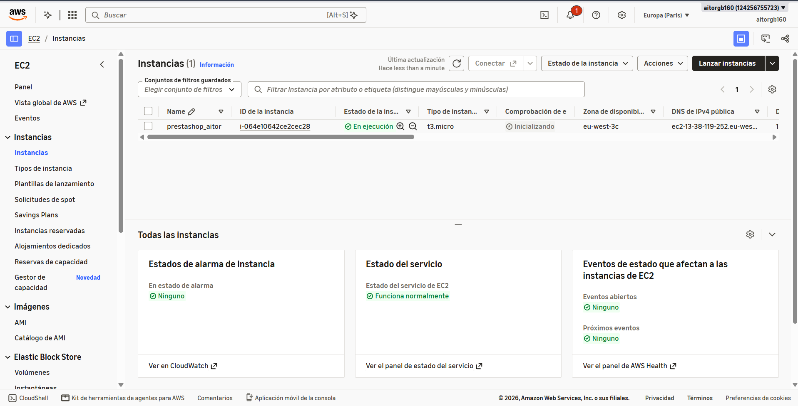
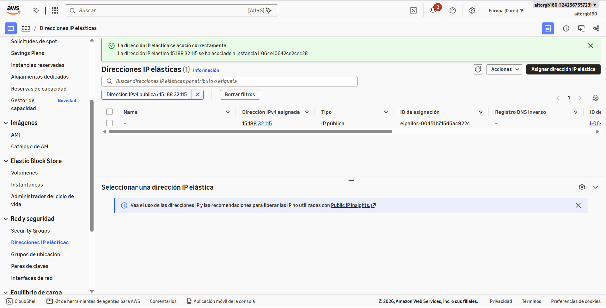
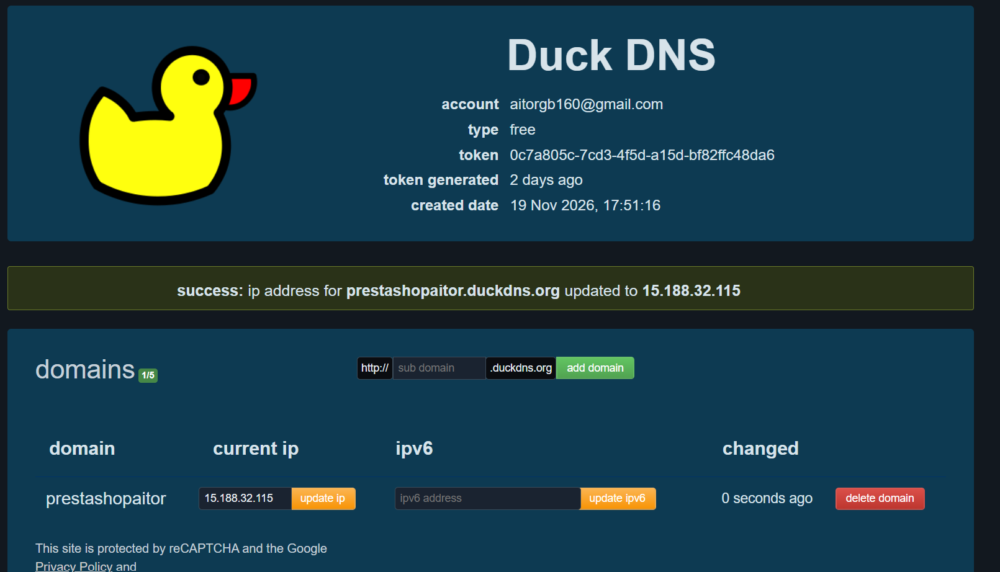
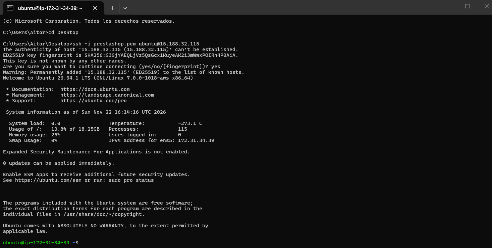
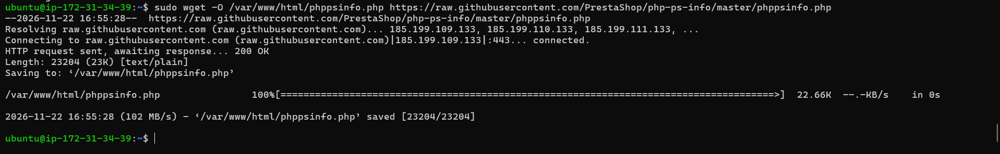
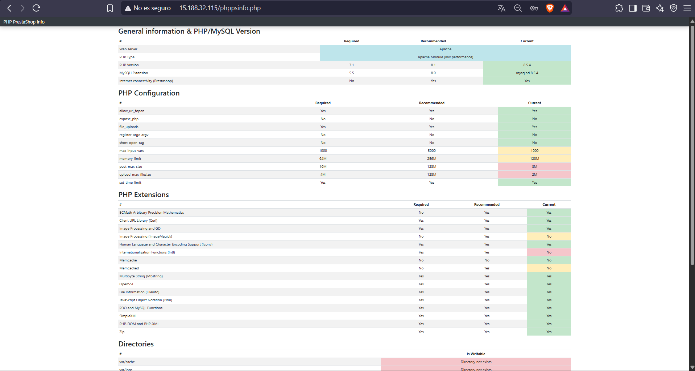
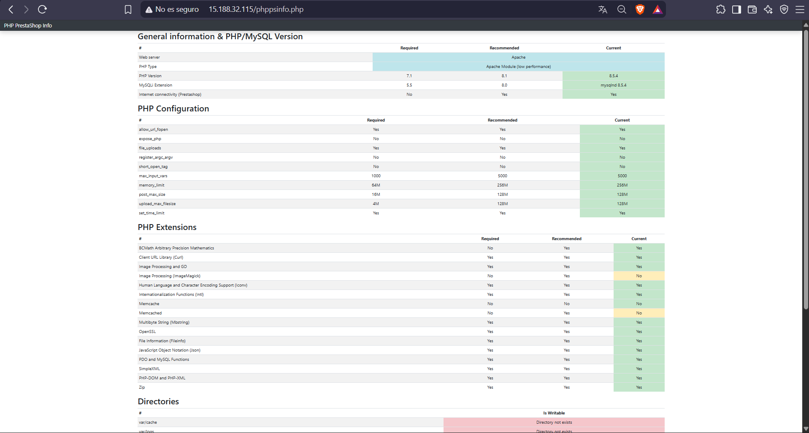
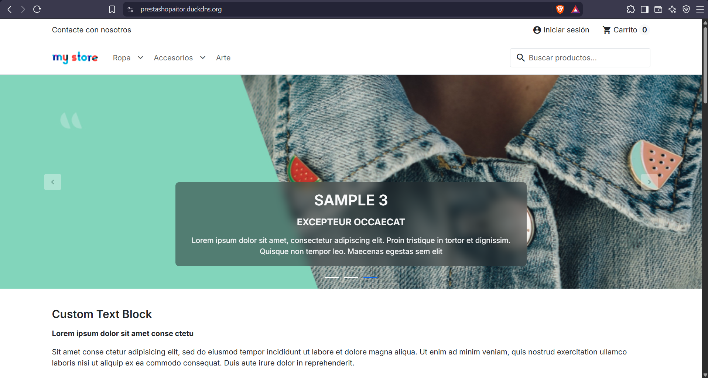
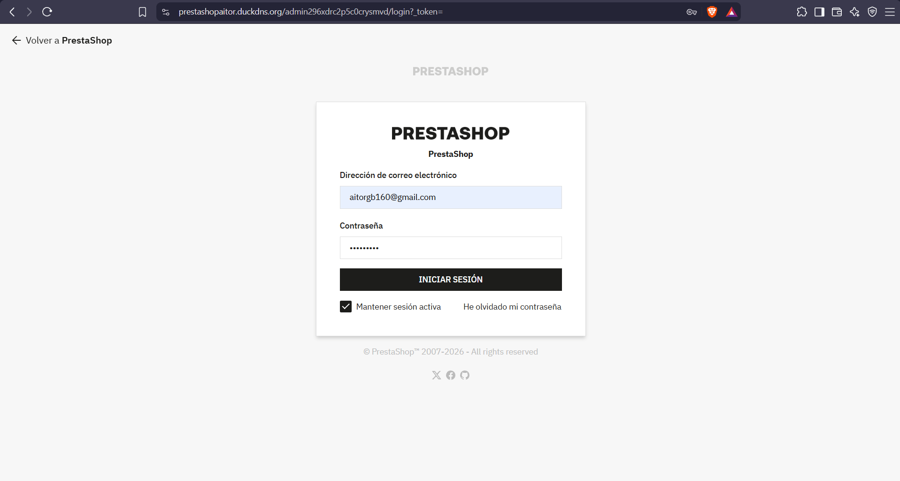
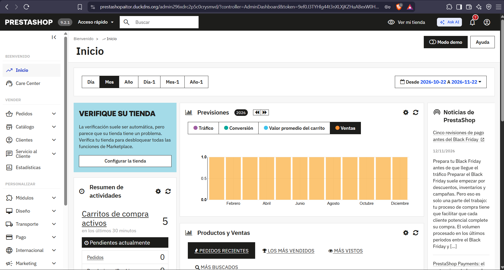

# Implantación de PrestaShop en AWS
**Alumno:** Aitor Guerrero  
**Dominio:** https://prestashopaitor.duckdns.org

## 1. Creación de la instancia EC2
Se ha creado una instancia EC2 con las siguientes características:
 
- **AMI:** Ubuntu Server 26.04 LTS.
- **Tipo de instancia:** t3.small (2 GB de RAM).
- **Almacenamiento:** 20 GiB.  
  

### Configuración de la instancia
Durante la creación de la instancia se configuró un **grupo de seguridad** con los puertos 22 (SSH), 80 (HTTP) y 443 (HTTPS) abiertos, y se creó un par de claves RSA para conectar por SSH. Después se asignó una IP elástica a la instancia para que su dirección no cambie al reiniciarla.  
  

## 2. Nombre de dominio
Se ha registrado el dominio prestashopaitor.duckdns.org en DuckDNS y se ha configurado para que apunte a la IP elástica de la instancia 15.188.32.115  
  

## 3. Conexión por SSH
La conexión con el servidor la vamos a realizar con el siguiente comando en el cmd donde tengamos descargado el .pem al crear el par de claves, en mi caso lo guardé en el escritorio:
```bash
ssh -i prestashop.pem ubuntu@15.188.32.115
```
  

Una vez dentro del servidor, se crean las carpetas del proyecto y los archivos de configuración y scripts:
```bash
mkdir -p ~/practica/conf ~/practica/scripts
cd ~/practica
nano conf/000-default.conf
nano scripts/.env   # se rellenan las variables con los valores reales
nano scripts/install_lamp.sh
nano scripts/setup_letsencrypt_https.sh
nano scripts/deploy_prestashop.sh
cd scripts
```
## 4. Instalación de la pila LAMP y phpMyAdmin
```bash
sudo bash install_lamp.sh
```
El script actualiza el sistema, instala Apache, MySQL, PHP y phpMyAdmin (sin preguntas, usando `debconf`), crea un usuario administrador de MySQL y copia el archivo `conf/000-default.conf` a Apache.

## 5. Comprobación de requisitos con PhpPsInfo
Antes de instalar PrestaShop se ha descargado el script PhpPsInfo en `/var/www/html` y se ha accedido a él desde el navegador (`http://15.188.32.115/phppsinfo.php`) para comprobar si el servidor cumple los requisitos.
```bash
sudo wget -O /var/www/html/phppsinfo.php https://raw.githubusercontent.com/PrestaShop/php-ps-info/master/phppsinfo.php
```
  
Estos problemas se corrigen desde el script `deploy_prestashop.sh`.  
  

## 6. Certificado HTTPS con Let's Encrypt
```bash
sudo bash setup_letsencrypt_https.sh
```
El script instala Certbot con el plugin de Apache y solicita el certificado para el dominio, configurando además la redirección de HTTP a HTTPS.  

## 7. Instalación de PrestaShop
```bash
sudo bash deploy_prestashop.sh
```
El script realiza lo siguiente:
 
1. Instala las extensiones de PHP necesarias y activa los módulos `rewrite` y `headers` de Apache.
2. Modifica el `php.ini` (`memory_limit`, `post_max_size`, `upload_max_filesize` y `max_input_vars`).
3. Descarga la versión de PrestaShop indicada en `.env` desde GitHub y la descomprime en `/var/www/html`.
4. Crea la base de datos y el usuario de MySQL.
5. Instala PrestaShop desde la línea de comandos con `php index_cli.php`.
6. Elimina la carpeta `install` por seguridad y ajusta los permisos.

Después de la instalación se vuelve a ejecutar PhpPsInfo y los requisitos aparecen cubiertos. Una vez comprobado, se elimina el archivo del servidor (`sudo rm /var/www/html/phppsinfo.php`).

  

## 8. Resultado final
Tienda online accesible desde `https://prestashopaitor.duckdns.org`:  
  
 
Panel de administración:
  

